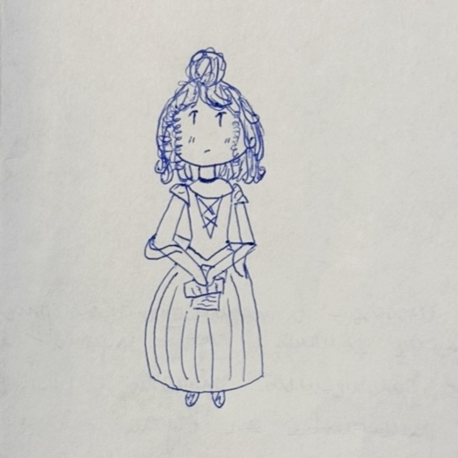

# Татьяна

Моя любовь -- в конверте старом.  
Листочек хрупкий... Где же был он?  
Он как засушенный гербарий --  
Вздохнёшь -- и станет горсткой пыли.

Судили обо мне, рядили.  
Увы, болтлив язык поэта!  
Когда б в моей то было силе,  
Сожгла б той ночью строки эти.

Письмо из раза в раз устало  
Твержу я вашими устами.  
Простите, девочки. Не знала,  
Что вас учить его заставят.

*2025 г., автору 13 лет.*

