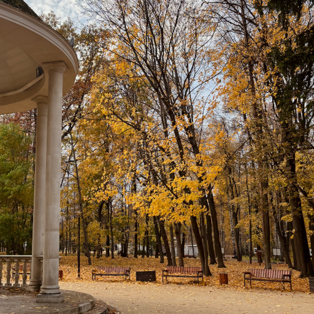

# Прохожий

Замечу средь усталых лиц  
Его туманную улыбку.  
Он щедро кормит белок, птиц,  
Идя по скверу в свете зыбком.

Он носит длинный в клетку шарф,  
Ботинки цвета капучино,  
Играет, как на струнах арф,  
На тонких нитях паутины.

Как листья клёна за окном,  
Дни пролетают с нашей встречи.  
Он мне назвался Октябрём.  
Вновь через год его замечу...

*Октябрь 2026 г., автору 15 лет.*

