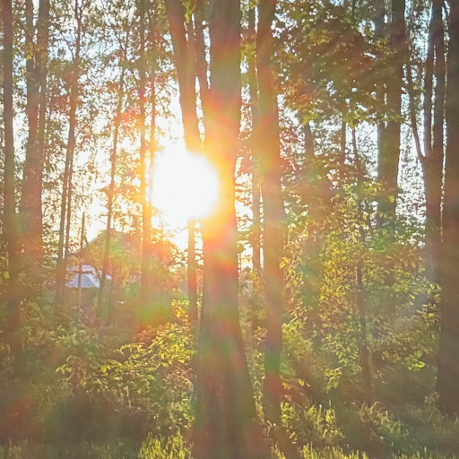

# Ожидание

Весна -- а может, не весна?  
Душой бы вырваться из сна,  
Но тает света полоса,  
Приходят холода.

Не видно небо синее,  
И ночь безумно длинная,  
Подумаешь с унынием,  
Что это навсегда.

Но вдруг незримая рука  
Раскрасит кистью облака,  
И вот рассвет издалека  
Всё ярче и светлей.

Мир видится по-новому,  
Не мчишься сломя голову,  
С улыбкою особенной  
Душой среди полей.

*2025 г., автору 13 лет.*

